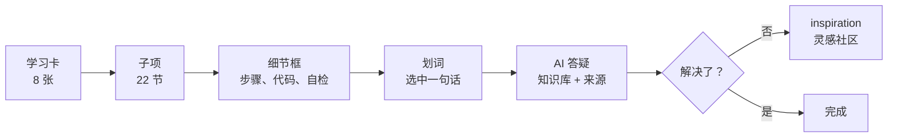
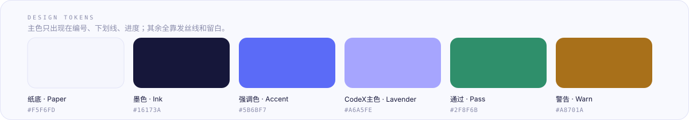

<picture>
  <source media="(prefers-color-scheme: dark)" srcset="assets/hero-dark.svg">
  
</picture>


> 一张卡就是一个 Task。翻过去，上一张会被「撕」下来贴到右侧；点开子项，细节框从卡里分裂出来；选中任意一句话，可以问 AI。

这不是视频课，也不是文档站，而是一个**可以直接点起来的学习界面原型**：把「我现在走到哪、这一步要做什么、卡住了问谁」全部做进界面，而不是写进另一篇文档里。

---

## 01 / 为什么是卡片

部署类内容最难的不是讲清楚，是让人**知道自己走到哪了**。所以这里没有目录页、没有侧边菜单，只有一张张可以翻的卡：

- 每张卡 = 一个 Task，卡上直接写着这一节要做什么、多久、几项验收
- 右侧那条队列 = 已经走过的路，随时能点回去
- 每个小节有自己的 Checklist，勾完才算过，进度不是「读过」，是「做过」

## 02 / 五个动作



| 动作 | 手势 | 你会看到 |
| :-- | :-- | :-- |
| 翻卡 | 滚轮 · 左右拖拽 · `←` `→` | 上一张沿弧线飞到右侧队列，新卡从后方浮上来 |
| 打开小节 | 点卡上的 `0.1` `0.2` `0.3` | 卡片上移缩小，细节框以模糊-对焦的方式从下缘生长出来 |
| 换小节 | 顶部标签 · 底部翻页 · `←` `→` | 内容按方向横向滑动，下划线从旧标签滑到新标签 |
| 求助 | 选中任意一句正文 | 冒出「遇到问题？问问我」，点开是引用该句的答疑卡 |
| 回看 | 点右侧任意小卡 | 跳回那一张，队列自动收敛 |

队列放不下时，最上面的卡会按倍率缩小、变淡。像滚轮收到顶。

## 03 / 设计语言

<picture>
  <source media="(prefers-color-scheme: dark)" srcset="assets/palette-dark.svg">
  
</picture>

**一、强调色只出现三处。** 编号（`0.1`）、当前下划线、进度条。其余全部交给发丝线（`1px / rgba(22,23,60,.09)`）和留白。满屏都想要重点，等于没有重点。

**二、一切「层级」靠位移和模糊，不靠投影。** 卡片进入用的是 `blur → 0` + `translateY`，不是 `box-shadow`。阴影只在需要「脱离页面」的地方出现（浮起的卡、dock、答疑卡）。

**三、数字用等宽。** `TASK 00`、`0.1 / 0.2`、`3 / 8`、`182 ms` 全是 mono 字体 + `tabular-nums`。进度、编号、时间在视觉上是同一类东西，就该长成同一类样子。

| Token | 值 | 用途 |
| :-- | :-- | :-- |
| `--paper` | `#F5F6FD` | 页面底色 |
| `--ink` | `#16173A` | 正文与标题 |
| `--accent` | `#5B6BF7` | 强调、编号、进度 |
| `--grad` | `#AAA8FF → #8B9BFF → #5B6BF7` | 品牌渐变（logo、按钮、下划线） |
| `--line` | `rgba(22,23,60,.11)` | 发丝线 |
| `--ease` | `cubic-bezier(.16,1,.3,1)` | 全局缓动 |

## 04 / 课程结构

当前结构均为AI生成的占位内容，具体内容需要开发同学和运营同学进一步研究和生产。

## 05 / 开工

```
.
├── how-to-build-up-CodeX.html
├── README.md
├── .gitignore
└── assets/
    ├── hero-light.svg      # README 头图（亮）
    ├── hero-dark.svg       # README 头图（暗）
    ├── palette.svg         # 色板（亮）
    └── palette-dark.svg    # 色板（暗）
```

没有构建步骤，没有 `npm install`，没有 `dist`。

```bash
# 直接双击，或者起一个静态服务
python -m http.server 8080
# → http://localhost:8080/how-to-build-up-CodeX.html
```

首次打开会自动播放 8 步新手引导（右上角随时 `?` 重看，或加 `?tour=1` 强制触发）。

## 06 / 键盘与手势

| 操作 | 效果 |
| :-- | :-- |
| `←` `→` | 翻卡；详情打开时改为切换小节 |
| `Esc` | 逐层关闭：答疑卡 → 细节框 → 面板 |
| 滚轮 / 拖拽 | 翻卡（细节框内可正常滚动） |
| 鼠标贴左边缘 | 唤出隐藏侧栏，3 秒无操作自动收起 |
| 右下角 `?` | 重看新手引导 |

## 07 / 实现备忘

单个 HTML 文件，约 2,300 行，零依赖。几个值得一看的地方：

- **撕卡**：`tearFly` 关键帧 + FLIP 实算位移（`--dx/--dy/--s`），落地尺寸与右侧缩略图完全一致，不会「跳一下」
- **分裂**：细节框以 `transform-origin: top center` 从 `scale(.3,.015)` + `blur(16px)` 生长，中间一条 `blur(7px)` 的「液体颈」连接卡片
- **缩略图**：右侧队列不是简化版，是把整张卡按 `scale(186 / 卡片宽度)` 缩放后塞进裁剪容器 —— 所以缩略图和原卡长得一模一样
- **光圈**：新手引导用 `box-shadow: 0 0 0 9999px` 一次抠洞，再用 `trackFor()` 每 16ms 贴住目标，动效演到哪光圈跟到哪
- **持久化**：`localStorage` 两个键 —— `codex-cards-v1`（勾选进度）、`codexTourV2`（是否看过引导）

> **关于 AI 答疑**：目前是关键词规则模拟（`AI_RULES`），答案与「来源」都是预置的。接真实知识库时替换 `matchRule()` 即可，调用处与 UI 不用动。

## 08 / 路线图

- [x] 卡片剧场、撕贴翻页、轮盘队列
- [x] 子项分裂、方向切换、分节清单
- [x] 划词答疑（规则demo）、反馈到社区
- [x] 8 步新手引导，首访自动执行
- [ ] 接真实知识库（检索 + 引用）
- [ ] 主页与 inspiration 灵感社区（现在是占位）
- [ ] 移动端手势细化（左右滑切换小节）

<p align="center"><sub>Fe1ixFe1icis</sub></p>
